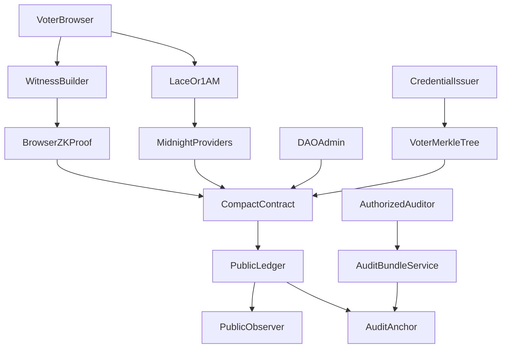
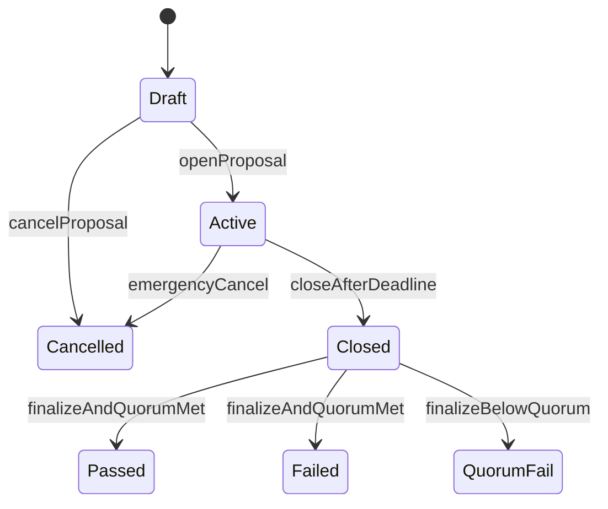

# Private DAO Voting on Midnight — Technical Design

## 1. Product goal

Private DAO Voting gives decentralized organizations an auditable governance system without publishing each member's identity or ballot. An eligible member proves the right to vote in zero knowledge, casts a Yes, No, or Abstain ballot, and consumes a proposal-specific nullifier that prevents a second vote. The ledger exposes the proposal rules and aggregate result, not the voter-to-ballot relationship.

The project is categorized as **Identity / credentials** because its core primitive is a private eligibility credential: “I am authorized under this proposal's rules” without revealing which authorized member I am.

## 2. Scope and delivery tiers

### Core

- Lace and 1AM wallet connection on Midnight Preview
- DAO administrator creates and opens a proposal
- Equal-weight Yes / No / Abstain ballots
- Merkle membership proof against an approved voter root
- Proposal-specific nullifier and duplicate-vote rejection
- Public aggregate tallies and deterministic quorum result
- Browser proof generation, contract join, state refresh, and transaction recovery

### Advanced

- Equal-weight or weighted voting selected per proposal
- Proposal-specific eligibility rules
- Up to four accepted credential issuers in the browser-sized circuit
- Privacy-preserving audit bundles anchored to public contract state

### Stretch

- Single-level delegated voting
- Delegation cannot be chained, reused, or combined with the delegator's direct vote
- Sealed-until-close weighted tally if public per-transaction weight deltas create unacceptable leakage

The advanced and stretch capabilities are required product directions, but they are not represented as already implemented. Each must pass the verification gates in section 14 before being promoted into the production contract.

## 3. Participants

- **DAO administrator:** registers accepted issuer roots, creates proposals, and closes eligible proposals. Administrative actions are authorized by a secret whose public commitment is stored on the ledger.
- **Credential issuer:** creates a registry of voter commitments and publishes its Merkle root. An issuer does not learn how a member votes.
- **Voter:** holds a private membership secret, salt, Merkle path, and optional voting weight. The voter generates proofs locally.
- **Delegate:** receives one or more constrained delegation capabilities and casts an effective vote without revealing delegator identities.
- **Auditor:** verifies public state and optionally decrypts a narrowly scoped aggregate audit bundle. An auditor must not receive voter identity-to-ballot mappings.
- **Observer:** reads proposals, nullifiers, and aggregate results from the public ledger.

## 4. Trust and privacy model

### Public information

- Contract address and administrator commitment
- Proposal identifier, title/content digest, opening and closing slots
- Voting mode, quorum rule, accepted issuer-root commitment, and eligibility-rule digest
- Aggregate Yes / No / Abstain totals
- Proposal-specific spent nullifiers
- Final status: Passed, Failed, Quorum not met, or Cancelled
- Audit-bundle digest, if an audit bundle is issued

### Private information

- Voter identity, private membership secret, salt, and Merkle leaf index
- Merkle authentication path
- Individual ballot choice and its relationship to a transaction sender
- Individual weight, unless the selected mechanism necessarily reveals a public delta
- Which accepted issuer vouched for a voter
- Delegator identity and delegator-to-delegate relationship

### Explicit metadata caveats

- A running tally reveals that a ballot was counted at a particular time and can reveal the selected branch through the changed counter. It does not reveal the member's credential identity, but external timing correlation remains possible.
- A running weighted tally can expose the weight delta. A distinctive public weight may become identifying when combined with outside knowledge. Weighted mode therefore requires bucketed weights or sealed-until-close aggregation before production use.
- Wallet and network metadata are outside the Compact circuit's privacy boundary.

## 5. System architecture



### Component boundaries

1. **Browser application:** React UI, wallet lifecycle, contract deploy/join, witness assembly, proof progress, state refresh, and recoverable errors.
2. **Voting core:** pure TypeScript modules for canonical hashing, membership trees, nullifier derivation, quorum evaluation, proposal rules, and tally projections.
3. **Compact contract:** enforces authorization, proposal state transitions, membership, nullifier freshness, ballot validity, and public tally updates.
4. **Disclosure module:** creates encrypted aggregate audit bundles and verifies them against ledger anchors. It never becomes a trusted source for the public result.

Business rules that affect trust must be enforced in Compact. Browser checks exist for fast feedback, not as security controls.

## 6. Public data model

### Proposal

```text
proposalId
contentDigest
createdSlot
opensAt
closesAt
status
votingMode              Equal | Weighted
quorumKind              Absolute | Percentage
quorumValue
eligibleCountOrWeight
issuerPolicyDigest
eligibilityRuleDigest
yesTotal
noTotal
abstainTotal
result
```

Proposal rules become immutable when the proposal enters `Active`. Changing roots or quorum after voting starts would invalidate the meaning of prior proofs and is forbidden.

### Credential issuer

```text
issuerId
issuerRoot
credentialTypeDigest
validFrom
validUntil
enabled
```

The browser-sized MVP uses a fixed upper bound on accepted roots. Dynamic or unbounded root sets are not assumed until a Compact spike proves a safe representation.

### Nullifier

```text
nullifier = H("dao-vote:nullifier:v1", voterSecret, proposalId)
```

Domain separation prevents accidental reuse across applications. Including `proposalId` makes a member's nullifiers unlinkable across proposals under the hash assumption. The circuit derives the nullifier from the same secret used to prove membership and rejects a nullifier already consumed by that proposal.

## 7. Proposal lifecycle



- Only the administrator may create, open, or cancel a proposal.
- Votes are accepted only while `status == Active` and the current slot is inside the voting window.
- Closing cannot alter proposal rules or totals.
- Finalization is deterministic from the stored tally and quorum configuration.

## 8. Voting mechanisms

### Equal voting

Each valid credential contributes exactly one unit to one tally. This is the core mode and must ship first because it has the clearest privacy and circuit-size profile.

### Weighted voting

Each voter leaf commits to a weight. The Merkle-sum tree binds the individual weight and aggregate eligible weight. The circuit proves:

1. the leaf is part of the proposal's approved tree;
2. the supplied weight matches the committed leaf;
3. internal sums and the published total are consistent;
4. exactly one tally receives the valid weight.

Running weighted totals are acceptable only when weights are bucketed or non-identifying. Otherwise, the implementation switches to sealed-until-close aggregation.

### Quorum

Participation is `yes + no + abstain` for equal voting and the corresponding sum for weighted voting. At finalization:

- Absolute quorum: participation must be at least the configured value.
- Percentage quorum: `participation * denominator >= eligibleTotal * numerator`.

Boundary arithmetic must use integer comparisons and avoid floating-point calculations.

## 9. Proposal-specific eligibility and multiple issuers

A proposal stores an immutable digest of its eligibility policy. Rules may include:

- accepted credential types;
- accepted issuer roots;
- minimum or bucketed voting weight;
- committee or membership class;
- credential-validity window.

The preferred multi-issuer model is a fixed-size list of accepted roots with a private selector, or a unified super-tree containing issuer-tagged voter commitments. The issuer used by the voter must remain private unless the proposal explicitly declares issuer identity public.

The final design depends on the multi-root Compact spike. Browser-only evaluation is never sufficient to enforce eligibility.

## 10. Delegated voting

Delegation is deliberately restricted:

- one level only;
- no re-delegation;
- proposal-specific;
- revocable only before voting starts;
- consumable once;
- delegator cannot also vote directly.

A delegation capability binds the proposal, delegator commitment, delegate commitment, and delegated weight. A delegation nullifier prevents reuse. Casting a delegated vote must consume both the delegate's vote nullifier and every included delegation capability without publishing the delegators' identities.

Because delegation compounds nullifier storage and private weight aggregation, it is implemented only after the core nullifier mechanism and weighted voting pass mechanical verification.

## 11. Auditor selective disclosure

Public ZK verification already proves that accepted transitions satisfy the contract. Selective disclosure exists for additional organizational evidence, not to make an unverifiable tally trustworthy.

An audit bundle may contain:

- proposal configuration and ledger-state digest;
- aggregate participation and quorum calculation;
- counts by non-identifying credential category;
- rule-compliance flags;
- audit generation time and software version.

It must not contain voter identities, individual ballots, raw Merkle paths, voter secrets, or reversible nullifier mappings. The bundle is encrypted to the auditor's public key and its digest is anchored to public state. Verification recomputes the digest and checks it against the contract anchor.

## 12. Browser application flow

1. Detect Lace and 1AM installations.
2. Connect the selected wallet and confirm the configured network.
3. Load DUST/readiness state and build the Midnight provider stack.
4. Deploy a fresh voting contract or join a stored compatible contract.
5. Load proposal state and the user's local credential witness.
6. Validate witness shape and proposal eligibility locally.
7. Generate and submit the ZK vote transaction.
8. Refresh ledger state and display the transaction identifier and aggregate result.
9. If ZK assets changed, reject the stored contract and ask the user to clear/redeploy.

Detailed flows are in `docs/FLOWS.md`; recovery behavior is in `docs/ERROR_HANDLING.md`.

## 13. Security invariants

- A public transition never contains a voter identity, secret, leaf index, Merkle path, or identity-to-ballot mapping.
- Exactly one of Yes, No, or Abstain is counted per accepted direct ballot.
- An eligible credential can contribute at most once per proposal.
- A nullifier cannot be chosen independently of the membership secret.
- Proposal rules and roots cannot change after activation.
- A malformed or non-member witness cannot alter a tally.
- Final status is a deterministic function of immutable rules and accepted totals.
- An auditor bundle cannot override or replace ledger truth.
- A delegation cannot be consumed twice, chained, or combined with the delegator's direct vote.
- Domain tags differ for voter leaves, tree nodes, vote nullifiers, delegation nullifiers, and audit anchors.

## 14. Compact / Midnight support status

Evidence-based status for Compact `language_version >= 0.23` and the current browser stack:

### Confirmed primitives

- Spent-nullifier storage with `Set` + `member` / `insert`, as in Compact `election` and `zerocash` examples
- Merkle membership via path checks and `HistoricMerkleTree.checkRoot` for live registries
- Public tallies via `Counter` increments
- Proposal-specific state via nested ledger `Map` values
- Explicit selective disclosure via `disclose()` of public properties, booleans, commitments, and nullifiers

### Custom protocol designs (not built-in ADTs)

- Multi-issuer “membership in one of N roots” without leaking the chosen issuer root
- Private weighted tallies: `Counter.increment(w)` publishes `w`, so private weights need commitments, buckets, or sealed-until-close
- Encryption to an auditor key: Compact selective disclosure is public `disclose()`, not auditor-only encryption
- One-level delegated voting: build from nullifiers + Merkle credentials; no stdlib delegation ADT

### Remaining mechanical spikes before locking production circuits

1. Nested `Map<proposalId, Set|Counter|config>` under the pinned midnight-js / Preview runtime
2. Equal-weight private ballot → public counter branch without unintended disclosure
3. Multi-issuer membership that does not fingerprint the issuer via a disclosed root
4. Browser prover size for membership + nullifier + tally; target below the deployment asset limit
5. Delegation consumption semantics and interaction with direct-vote nullifiers
6. Auditor aggregate bundle path: off-chain encrypt + on-chain digest anchor

If a spike fails, the architecture must change rather than moving the missing enforcement into trusted browser code.

## 15. Test strategy

### Pure TypeScript

- Nullifier determinism, proposal separation, and domain separation
- Quorum exact-boundary, below-boundary, percentage, and zero-eligible cases
- Proposal transition validity
- Eligibility policy matrix
- Merkle membership and weighted-sum integrity
- Public serialization excludes private witness fields

### Compact/runtime

- Authorized proposal creation and unauthorized rejection
- Valid member vote increments exactly one tally
- Invalid membership rejection
- Duplicate nullifier rejection
- Vote before open / after close rejection
- Finalization at and below quorum
- Tampered weight rejection

### Browser integration

- Connect, deploy, join, vote, refresh, and disconnect
- Wrong-network and insufficient-DUST recovery
- Stored verifier mismatch recovery
- Busy mutex prevents overlapping wallet actions
- Proof timeout does not leave the UI permanently busy

### Disclosure

- Correct audit bundle verifies against ledger anchor
- Tampered bundle fails verification
- Bundle schema rejects identity and individual-ballot fields

## 16. Deployment and observability

- Pin mutually compatible Compact compiler, runtime, ledger, connector, and Midnight JS versions.
- Compile generated bindings and ZK assets locally before deployment.
- Fingerprint ZKIR and bind stored contract addresses to that build identifier.
- Serve verifier/prover/ZKIR files as binary assets with explicit CORS and content types.
- Run unit tests, type checking, asset verification, and a Preview smoke test in CI.
- Logs may include step names, transaction IDs, block heights, and public proposal IDs. Never log voter secrets, witness paths, ballot choices, or decrypted audit bundles.

## 17. Delivery roadmap

### Level 4 Core MVP

- Equal-weight Compact contract and browser dApp
- Membership, nullifier, tally, proposal lifecycle, and quorum
- Automated tests, CI, Preview deployment, hosted demo, and documentation
- Privacy model stating public ledger state, private witnesses, and disclosure

### Advanced follow-ons

- Weighted voting
- Proposal-specific eligibility
- Multiple credential issuers
- Selective audit disclosure
- Single-level delegation after all nullifier invariants pass
- UX polish, security review, and final demonstration
