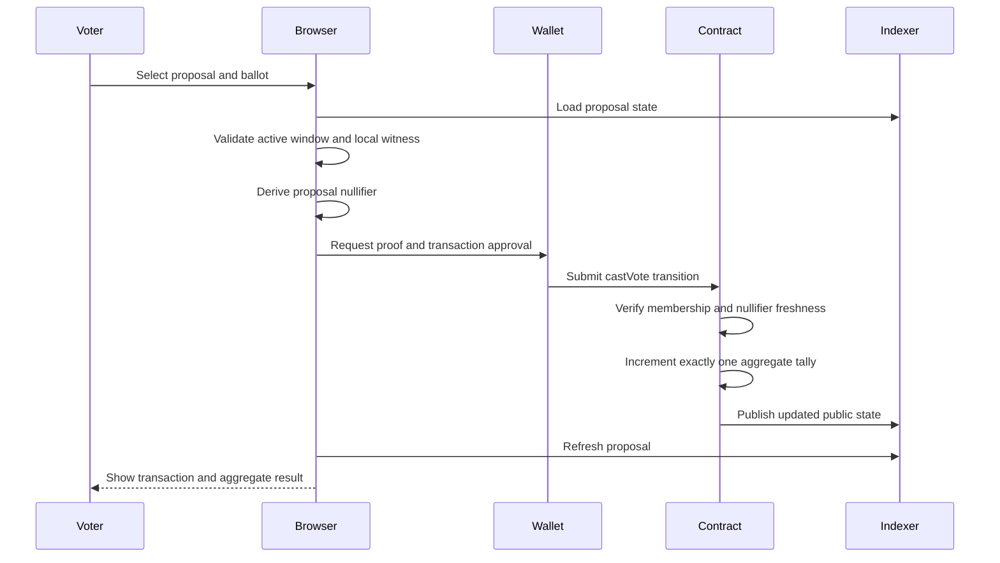

# Application Flows

## 1. Administrator setup

1. Connect an administrator wallet on the configured Midnight network.
2. Deploy a voting contract with an administrator-key commitment.
3. Register one or more credential-issuer roots.
4. Create a proposal with content digest, voting window, voting mode, quorum, and eligibility rules.
5. Review the immutable summary.
6. Open the proposal. Rules and roots are now locked.

Failure handling:

- Wrong network blocks deployment before a transaction is balanced.
- Invalid opening/closing slots are rejected before proof generation.
- Unsupported issuer count or rule shape is rejected by the browser and contract.
- A failed deployment leaves no stored address.

## 2. Direct voting

The ballot choice, membership path, and voter secret remain witness data. The nullifier and new aggregate state are public.

## 3. Proposal finalization

1. Any observer sees that the closing slot has passed.
2. The administrator or permissionless finalizer submits `closeProposal`.
3. The contract freezes further votes.
4. `finalizeProposal` computes participation and evaluates quorum.
5. If quorum fails, status becomes `QuorumFail`.
6. Otherwise, the configured decision rule sets `Passed` or `Failed`.
7. Final totals and status remain permanently auditable.

## 4. Weighted voting

1. Proposal mode is fixed to `Weighted` before activation.
2. The voter loads a committed weight and Merkle-sum authentication path.
3. The circuit validates membership, committed weight, tree sums, and nullifier freshness.
4. The valid private weight is applied to exactly one aggregate.
5. If public deltas could identify voters, weighted mode uses configured buckets or sealed aggregation.

## 5. Multiple credential issuers

1. The proposal references an immutable accepted-issuer policy.
2. The browser discovers which local credential can satisfy the policy.
3. The voter supplies a private root selector and membership path.
4. The circuit proves membership in one accepted root without disclosing the selector.
5. The nullifier remains proposal-specific even if the same credential is used elsewhere.

## 6. Delegated voting

1. Before voting opens, a delegator creates a proposal-specific delegation capability.
2. The capability binds the intended delegate and voting weight.
3. The delegation is registered or committed without exposing the delegator's identity.
4. The delegate casts one ballot and supplies the delegation witnesses.
5. The circuit consumes delegation nullifiers and prevents direct votes from consumed delegators.
6. Re-delegation and delegation chains are rejected.

This flow is a stretch feature and must not be enabled until direct-vote and delegation nullifiers are proven composable.

## 7. Selective auditor disclosure

1. An authorized operator exports aggregate audit evidence.
2. The browser/service validates the bundle against current ledger state.
3. The bundle is scanned against the prohibited-field schema.
4. It is encrypted to the auditor's public key.
5. A digest is anchored on-chain or published alongside the contract address and block.
6. The auditor decrypts the bundle and recomputes the digest.
7. Verification succeeds only if the digest and referenced public state match.

## 8. Contract rejoin after refresh

1. The app reads `{ contractAddress, zkBuildId }` from local storage.
2. It compares the stored build ID with the current ZK asset fingerprint.
3. Compatible builds rejoin the contract automatically once.
4. A mismatch clears the unsafe session and asks the user to deploy or enter a compatible address.
5. Failed joins expose a retry action and never loop indefinitely.

## 9. UI state model

Wallet phase:

`idle → connecting → connected → error`

Contract phase:

`none → joining|deploying → ready → proving|submitting → ready|error`

Proposal phase:

`draft → active → closed → passed|failed|quorum-fail|cancelled`

Only one wallet operation may be active at once. Every async operation clears its busy state in `finally`.
